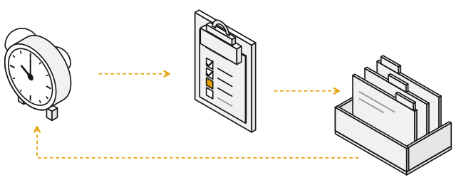

# autopilot

**Website:** https://honghao.me/autopilot/ (English / 中文) <!-- checkpkg: ignore -->

A Claude Code plugin for macOS. Hand it a body of work (a Jira epic, one big
Jira ticket, or an idea) and stay **on** the loop, not in it: it plans the
work, splits it into PR-sized tasks, runs workers, reviews them, merges where
you allow it, and keeps one page of what needs you.

autopilot is a **fresh-session loop**. The obvious way to keep Claude working
for days is one long session prompted on a timer, but that conversation is
compacted again and again, and the rules you gave it fade, even with memory
files; the timer also dies with the session. Here every step is a new, empty
Claude session that reads its memory from files, does one step, writes down
where things stand, and exits. The rules that matter most are enforced by code
and permissions that a pass cannot change. The price: no session is always on
call. When you have questions, you open one (`/autopilot <name>`).



| Part | What it is | Uses tokens |
|------|------------|-------------|
| The check (`ap gate`) | Plain code that a launchd login item runs every minute and after each restart. It fingerprints finished work, dead workers, ready tasks against free slots, CI and reviews on open PRs, and your watch commands | No, except one tiny Haiku read of your page's answers (outside the quiet hours, `reply_check.quiet`, only while a card can be answered; in the quiet hours only while the daily-cap card is open) |
| A pass | A new background Claude session, started when the fingerprint changed or 30 minutes passed. It reads `RUNBOOK.md`, your rules and the state file, handles finished work, fills free worker slots, writes reports, publishes the page, and exits. One at a time, under a lock | Yes |
| Workers | Background sessions, one per task and role (implement, review, PR loop), each in its own git worktree. Each writes a report and kicks the check when done | Yes |
| A talk session | Any Claude Code session where you type `/autopilot <name>`. A hook adds a fresh snapshot to every message | Yes, while you chat |

## Requirements

- **macOS.** The check is a launchd login item
  (`~/Library/LaunchAgents/com.autopilot.gate.plist`); no other platform is
  supported.
- **Claude Code**, signed in (`claude auth status`), with background sessions
  (`claude --bg`, `claude agents`, `claude attach`). The code checks no
  minimum version; the design was checked on Claude Code 2.1.317.
- **claude.ai.** The page is a claude.ai artifact, published from background
  sessions with the Artifact tools; reading your answers on it needs the
  claude.ai sign-in.
- **GitHub CLI** (`gh`), signed in (`gh auth login`), and **git**.
- **python3.** `bin/ap` is Python 3 with the standard library only.
- **A shell that sets up each project.** Each background session starts with
  the environment your login shell has after `cd` into the session's folder
  (and that folder's direnv `.envrc`, when it has one), not launchd's. A tool
  that needs variables from your shell, such as a nix `git` and its
  `NIX_SSL_CERT_FILE`, works the same as in your terminal. `ANTHROPIC_*` and
  `CLAUDE*` variables still come from the gate, so a key in your profile never
  changes how a session signs in or bills. zsh, bash, sh and
  ksh are read; with another shell, or `AUTOPILOT_PROJECT_ENV=off`, a session
  keeps the gate's environment.
- **Jira sources only:** Jira tools (an Atlassian MCP server) that load in
  Claude Code from the repo the autopilot works in.
- **Recommended:** the Xcode command line tools (a C compiler). Installing the login item compiles a small launcher into
  `~/Library/Application Support/autopilot/`. Without a C compiler the login
  item runs `bin/ap` directly, and macOS refuses that when the plugin sits in
  a cloud-synced folder (for example a synced `~/.claude`).

## Install

Clone the repo into your skills folder:

<pre><code>git clone https://github.com/agate/autopilot.git ~/.claude/skills/autopilot</code></pre><!-- checkpkg: ignore -->

Claude Code loads a plugin in `~/.claude/skills/<name>/` in every new session
(as `autopilot@skills-dir`), so `/autopilot` and its hooks work in any session
with no extra flags. Start a new session after cloning.

## First steps

1. **Set up an autopilot.** In a new Claude Code session, run:

   ```
   /autopilot init
   ```

   It asks one multiple-choice question at a time, each with a default, and
   never asks what it can look up: it reads the source (the Jira epic or
   ticket, the repo) first. The questions: a short name, the source, the repo,
   the branch pattern, single-use resources (an emulator, a test device), the
   authority (what it may do without asking), report times, anything to watch,
   and whether to also publish to a company host. It reads the whole setup back
   and writes files only after your yes.

2. **The page.** On the first init it publishes your page on claude.ai: cards
   that wait on you come first, each with its links and answer buttons; then
   status, progress and workers. Only the page's owner can answer. The page
   and reports are in your language (taken from `~/.claude/CLAUDE.md`) next to
   English.

3. **The login item.** If it is not installed, init asks before installing it.
   On yes it runs `ap install`; Claude Code may ask you to approve that call.
   If the call is refused, init prints the exact line to run yourself with `!`.

4. **Check health.** Run `/autopilot doctor`. Each failure comes with the line
   that fixes it.

5. **Start now** (optional): `/autopilot tick <name>` queues a first pass; the
   check starts it within seconds. Otherwise the first pass comes on its own.

From then on, watch the page, answer what only you can, and undo what the
autopilot decided by itself if you disagree. The few calls of its own that are
worth a look (they change the scope or the spec, are hard to undo once merged,
or change what people see) sit on top with OK and Undo; the routine rest fold
into one line, and each task's evidence page lists the ones made for it. Once
10 routine ones are unread, or the oldest is 3 days old, the reports and the
page remind you in one line (`self_review` in `ap config`).

## Commands

The first word after `/autopilot` decides; anything else is a conversation.
Saying "pause checkout" or "run checkout now", in any language, means the same
as the command.

| Command | What it does |
|---------|--------------|
| `/autopilot init` | Set up an autopilot (questions, playback, then files, page and login item) |
| `/autopilot <name> [text]` | Bind this session to that autopilot and talk: ask anything, answer its cards, change things in plain words |
| `/autopilot [text]` | No name: ask which autopilot first (or say which one, when there is only one), then talk |
| `/autopilot status` | One line per autopilot (running, waiting on you, done), plus the usage budget |
| `/autopilot doctor` | Health check: login item, recent check runs, logins, settings files, MCP servers, disk space, and that the plugin names nobody |
| `/autopilot config` | List the settings, the changed ones first; change one on your word |
| `/autopilot profile ...` | Profiles: list, show, add, switch, rotate (see Profiles); plain words work too |
| `/autopilot tick [name]` | Queue a pass now; the check starts it within seconds |
| `/autopilot pause <name>` / `resume <name>` | Pause an autopilot, or let it run again |
| `/autopilot stop <name>` | Asks first, then ends its workers and marks it stopped |
| `/autopilot off` | Unbind this session |
| `/autopilot uninstall` | Asks first, then removes the login item |

To talk to one worker directly, attach to its background session:
`claude attach "<session name>"` (names look like
`checkout · PROJ-123 · implement`).

## Profiles

A profile says how workers reach Claude. The built-in `subscription` profile is your
Claude login (it also holds the model and effort settings that were global before). A gateway
profile points Claude Code at an LLM gateway with its own key. Only workers and one-off
actions use the active profile. The dispatcher pass, the answer read and the page refresh always
use the subscription, because a gateway session cannot use the claude.ai Artifact tools.

```
ap profile add team-gateway --gateway \
  --base-url https://llm-gateway.example.com/anthropic \
  --key-command ~/bin/llm-key \
  --refresh-command "~/bin/llm-key --refresh" \
  --rotate-command "~/bin/llm-key --rotate" \
  --model claude-sonnet-5-5 --effort high --daily-cap 500 \
  --env API_TIMEOUT_MS=960000
ap profile list              # * marks the active profile
ap profile use team-gateway  # switch; ap profile use subscription switches back
ap profile rotate team-gateway
```

A gateway profile requires four options: `--base-url`, `--key-command`, `--small-model` and `--daily-cap`.
A model name may end in `[1m]` (the 1M context window, as in `claude-opus-5-5[1m]`); the check against
`--models-command` ignores that suffix.
Other commands: `ap profile show <name>`, `ap profile remove <name>`. You can say the same in
`/autopilot` ("create a profile ...", "switch to the subscription", "rotate the key"). Options:
`--models-command`, `--dispatcher-model`, `--label`, `--settings-file`. A profile stores the
commands that print a key, never the key.

- **Choosing the model and effort.** A profile's model and effort are picked from a list fetched
  just then, the first time it is set up or used. `ap profile choices <name> [--json]` prints the
  models (a gateway's `--models-command` list, with the `[1m]` variant first for every Claude model but
  Haiku; on the subscription the priced Claude models and `default`), the efforts (`low` to `max`) and
  the recommended ones (`claude-opus-5-5[1m]` when offered, and `high`).
  `ap profile choose <name> --model M --effort E` checks the values against a fresh list and saves them.
  `ap profile add` without `--model` and `--effort`, and `ap profile use` on a profile not chosen yet,
  ask in a terminal (a numbered list; Enter takes the recommended entry). Without a terminal, `add`
  saves the profile unchosen and `use` switches nothing (exit 3); both print the choices as JSON.
  On the page, a switch to such a profile opens a "Choose model and effort" card instead: pick, confirm,
  and the gate checks the pick against a fresh list, saves it and switches. A card nobody answers closes
  after 6 hours, or when you switch profiles. The built-in `subscription` profile counts as chosen, and
  re-applying the active profile never asks.
- **Daily cap.** `--daily-cap` is dollars per local day. At the cap no new worker starts and
  running ones continue. One card on the page asks you to raise today's limit by 50% or 100%, or to
  pause. A raise adds to an earlier one, and the card opens again if spend crosses the raised limit.
  Pause pauses every autopilot and stops running workers; resume by hand. An unanswered
  card ends at local midnight, when today's spend starts again at $0, and workers start again. If some
  of today's cost cannot be priced, it counts as over the cap: the card names the unpriced models (or a
  launch that could not be read) and offers to accept today's unknown cost (it then counts as $0 for
  the cap until midnight, still shown as unknown) or to pause. To fix it for good, add the model's price
  under `prices`. A launch in its first 15 minutes that is not listed yet, or has no transcript yet, is
  not unknown cost. A resumed conversation is a new session that starts with a copy of the old one; the
  copied requests (dated before the session's first launch) are not counted again.
- **Key health.** If the key command fails, no new worker starts and the page shows the error with its
  fix. It never falls back to the subscription. Fix the key, or run `ap profile rotate <name>`.
- **Refused conversations.** When a gateway rejects a worker's conversation itself (an HTTP 400 from its
  safety guard), resuming it on the gateway never helps. The worker shows as blocked, and a card tells
  you to resume that one worker on the subscription and switch back.
- **Switching from the page.** The answer check applies the switch. It takes up to about 5 minutes (about 1 when a card
  is waiting). In the quiet hours (`reply_check.quiet`) the next forced pass applies it, so it can take up to
  `forced_pass_min` minutes. A cap answer takes effect within a minute, also in the quiet hours: the check keeps
  reading while the cap card is open. With `reply_check.every_s` at 0, passes apply both.
  Switching with `ap profile use` is immediate.

## What it may do on its own

The default authority, which `init` lets you tighten but not loosen:

| Does it without asking, then reports | Always asks first (a card on the page) |
|---|---|
| Worktrees, branches, commits, push, open PRs, start CI runs | Any chat message (it drafts the text) |
| Source status, links and descriptions inside the scope | Creating any ticket or epic |
| Merge, if allowed at init, after the PR loop is clean and the merge check passes | Comments on tickets, or anything posted as you |
| New work found inside the scope | Work outside the scope |
| Reversible decisions, each shown with an undo | Anything destructive |
| Force-push a branch it rebased, with `--force-with-lease` | Replying to or resolving a human's review thread, requesting reviewers, @-mentioning anyone |
| Push fixes for human review comments; resolve review-bot threads | A PR on any repo other than the autopilot's own |

The merge check passes only when any required approval is on the latest
commit, no human review thread is left unhandled, and CI is green on current
main. Passes and workers run with a permission floor that denies edits to
`RULES.md`, `config.json`, `state.json` and the plugin folder, and denies
`gh pr comment`, `gh pr review`, `gh issue comment`, `gh issue create` and
`gh pr edit --add-reviewer`. Something you approve on a card runs once, in a
separate session allowed only that tool.

The dispatcher's floor also allows, by rule, the steps a pass takes on work it
did not start itself: the tracker's ticket-status tool (found by tool
discovery), `gh pr ready`, `gh pr merge --match-head-commit` (only when
`authority.merge` is `true`, and only a merge pinned to the head commit the
merge check saw), and `ap worker end` (which stops only the workers this autopilot
started; a raw `claude stop` is never allowed). A pass starts with a fresh
context, so without these rules the auto-mode classifier sees no request from
you naming that ticket, PR or session and blocks the step; it also cannot see
that `ap merge-check` passed. Set `authority.source_status` or
`authority.open_prs` to `false` in an autopilot's `config.json` to drop the
ticket-status or the ready rule; the merge rule needs `authority.merge: true`
in every autopilot. The floor is shared, so one autopilot turning a rule off
turns it off for every pass. Run `ap perms write <ap>` after changing any of
them.

## System access

A login or connection every pass needs (GitHub, the page's claude.ai login, the MCP servers the
passes use, or a cloud login you declare) gets its own card at the top of the page when it breaks:
what broke, since when, what it blocks and the exact fix. The gate checks one of them before each
pass, never starts a login itself, and closes the card when a later check sees it working. See
`references/access.md` to add a check of your own.

## Configuration

`/autopilot config` lists every global setting with its default and marks the
ones you changed. Ask in plain words to change one; under the hood it runs
`ap config set key=value` (dotted keys for nested settings) or
`ap config reset key`. Only changed settings are saved, in
`~/.claude/autopilot-data/config.json`, so a new default in a later version
reaches you unless you changed that setting. The full list is in
[`references/config.md`](references/config.md). Some defaults:

| Setting | Default | What it does |
|---|---|---|
| `max_workers` | `5` | Most workers running at once, across all autopilots |
| `budget.window_pct` | `85` | Start no new work once a usage window reaches this percent |
| `budget.credit_pct` | `90` | Start no new work once extra credits reach this percent of the monthly limit |
| `budget.park_pct` | `90` | Running workers stop and wait once any usage window reaches this percent, and continue after it resets. A worker the API stopped at a usage or spend limit anyway is parked too, until the reset its error names (or a back-off from 30 minutes to 4 hours) |
| `forced_pass_min` | `30` | Run a pass at least this often, in minutes, even when nothing changed |
| `gate_interval_s` | `60` | How often the check wakes, in seconds; takes effect after `ap install` |
| `reply_check.quiet` | `["22:00", "06:00"]` | No answer reads between these times, except while the daily-cap card is open; the forced pass picks answers up then |
| `report_times` | `["09:00", "17:00", "21:00"]` | When reports are written, local time |
| `worktree_root` | `"~/worktrees"` | Where task worktrees are created |
| `permission_mode` | `"auto"` | Claude Code permission mode for passes and workers |
| `active_profile` | `"subscription"` | Access profile workers run on (see Profiles) |

Each autopilot's own setup (source, repo, branch pattern, resources,
authority, report times, watches) is written by `init` to
`~/.claude/autopilot-data/projects/<name>/config.json`. Your standing rules go in
`~/.claude/autopilot-data/RULES.md` (all autopilots) or the `RULES.md` in the
autopilot's own folder (one; `ap dir <name>` prints it): say a new rule in a talk
session, and it is written only after you say yes to the exact line. When the
two conflict, the autopilot's own rule wins. All data lives in
`~/.claude/autopilot-data/`; set `AUTOPILOT_DATA` to use another folder. An
autopilot made by an earlier version sits at `~/.claude/autopilot-data/<name>/`;
the gate moves it into `projects/<name>/` once none of its workers runs. The
name `projects` is reserved.

## Uninstall

1. Stop each autopilot you no longer want running: `/autopilot stop <name>`.
2. Remove the login item: `/autopilot uninstall` (it runs `ap uninstall`,
   which unloads the job and deletes its plist and launcher).
3. Delete the plugin folder: `rm -rf ~/.claude/skills/autopilot`.
4. Your data stays in `~/.claude/autopilot-data/` (and task worktrees under
   `~/worktrees`) until you delete them. The page on claude.ai stays too;
   delete it there if you want it gone.
